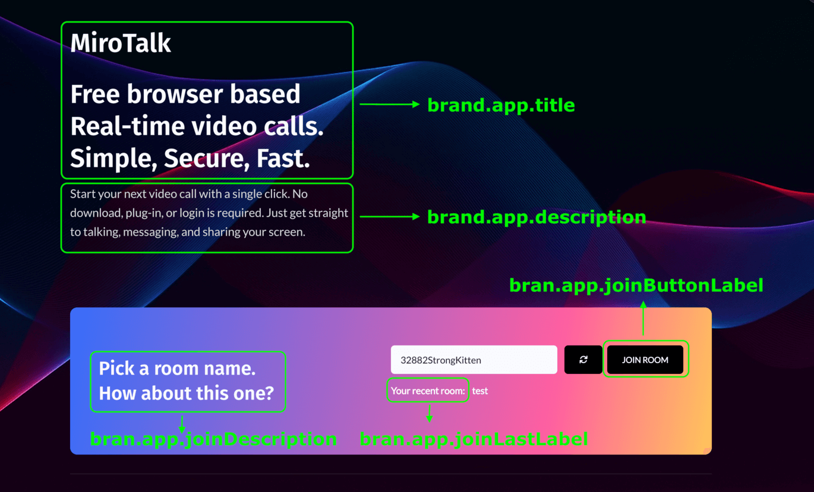
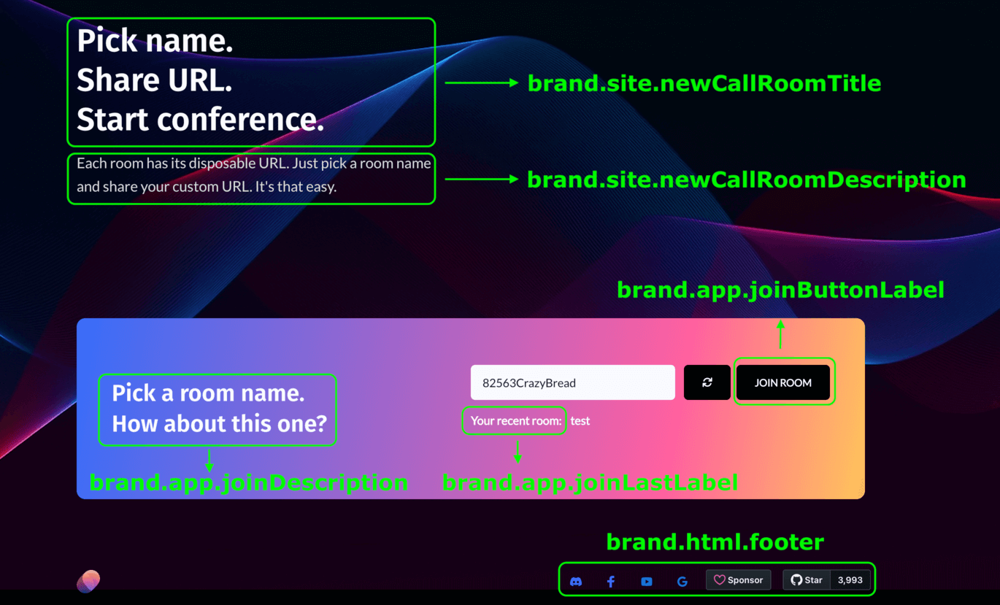
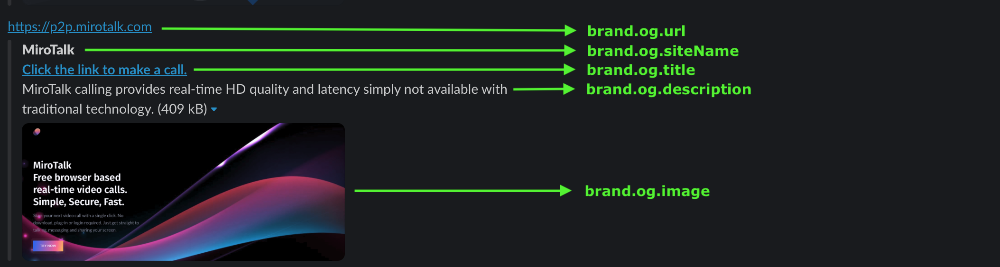

# Rebranding

!!! warning "License Required"

Rebranding requires at least a 👉 **[Regular License]({{ pricing.p2p.regular.url }})**.

---

P2P branding and UI customization are configured in `.env`. The latest `app/src/config.template.js` reads these environment variables and provides the defaults. If you already have a self-hosted installation, see the [update guide](updates.md) before migrating existing customizations.

---

## Approach 1 — HTML Injection (Recommended)

Set `BRAND_HTML_INJECTION=true` to customize the landing page and labels without editing frontend files:

```bash
BRAND_HTML_INJECTION=true
APP_NAME="Acme Meetings"
APP_TITLE="<h1>Acme Meetings</h1>Private browser-based video calls.<br />Simple, secure, fast."
APP_DESCRIPTION="Start a video call with one click. No download or login required."
JOIN_DESCRIPTION="Choose a room name.<br />Invite your guests."
JOIN_BUTTON_LABEL=JOIN
CUSTOMIZE_BUTTON_LABEL="CUSTOMIZE ROOM"
JOIN_LAST_LABEL="Your recent room:"
```

`APP_TITLE` is the landing-page heading; `SITE_TITLE` controls the page's browser title. Leave a text variable empty to use its built-in default.



### Landing page sections

Set a variable to `false` to hide its section. These options default to `true` when unset:

| Variable | Section |
| :--- | :--- |
| `SHOW_TOP_SPONSORS` | Top sponsors banner |
| `SHOW_FEATURES` | Features overview |
| `SHOW_TEAMS` | Teams section |
| `SHOW_TRY_EASIER` | "Try easier" callout |
| `SHOW_POWERED_BY` | Powered-by badge |
| `SHOW_SPONSORS` | Sponsors section |
| `SHOW_PAST_SPONSORS` | Past sponsors section |
| `SHOW_ADVERTISERS` | Advertisers section |
| `SHOW_SUPPORT_US` | Support-us section |
| `SHOW_FOOTER` | Page footer |
| `SHOW_VERSION` | App version in the footer |

### New room page



```bash
NEW_ROOM_TITLE="Pick a name.<br />Share the link.<br />Start your call."
NEW_ROOM_DESC="Choose a room name and share its URL with your guests."
```

Other page text and titles, including the join, login, and waiting-room pages, can also be customized in `.env`. See the **UI Customization (Branding)** section of the [environment template](https://github.com/miroslavpejic85/mirotalk/blob/master/.env.template) for the complete variable list.

---

## Open Graph (OG)

Control how your pages appear when shared on social media:



```bash
OG_TYPE=app-webrtc
OG_SITE_NAME="Acme Meetings"
OG_TITLE="Private browser-based video calls"
OG_DESCRIPTION="Secure, self-hosted video calls for your team."
OG_IMAGE_URL=https://meet.example.com/images/preview.png
OG_URL=https://meet.example.com
```

---

## Approach 2 — Full Customization

Set `BRAND_HTML_INJECTION=false` to use the static frontend views instead:

```bash
BRAND_HTML_INJECTION=false
```

Frontend views are located in `public/views`. Edit them directly for full control over the markup and design. These source-file changes can be overwritten by updates; see the [update guide](updates.md) for ways to preserve them.

---

## Reference

- Full environment configuration: [`.env.template`](https://github.com/miroslavpejic85/mirotalk/blob/master/.env.template)
- Config template that reads the environment variables: [`config.template.js`](https://github.com/miroslavpejic85/mirotalk/blob/master/app/src/config.template.js)
