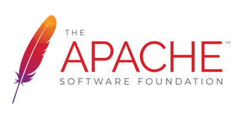

# MiroTalk P2P - Self Hosting


## Description

MiroTalk P2PA is a lightweight, self-hostable WebRTC solution for real-time audio, video, and screen sharing. Media is transmitted directly between peers (TURN recommended for NAT traversal), making it ideal for small teams, embedded apps, or private instances.

**Live demo**: [https://p2p.mirotalk.com](https://p2p.mirotalk.com)

## Requirements

- Server Selection:
    - [Hetzner](https://www.hetzner.com/cloud)
    - [Netcup](https://www.netcup.com/en/?ref=309627)
    - [Hostinger](https://hostinger.com/?REFERRALCODE=MIROTALK)
    - [Contabo](https://www.dpbolvw.net/click-101027391-14462707)
- OS: Ubuntu 22.04 LTS.
- [Node.js](https://nodejs.org/en/) (LTS) and npm
- Domain or Subdomain Name (e.g., `YOUR.DOMAIN.NAME`) with a DNS A record pointing to your server's IPv4 address.
- It is recommended to use a [TURN Server](../coturn/stun-turn.md). Installation documentation is available [here](../coturn/installation.md).

---

## Automated Setup

!!! tip "Quick Automated Installation"

    You can automate the entire setup (Node.js, Nginx, SSL, Docker) using our installation scripts on a clean Ubuntu server. Check out the [MiroTalk P2P Setup Script](https://docs.mirotalk.com/scripts/about/#mirotalk-p2p) for details.

---

## Installation


Install `NodeJS` and `npm` using [Node Version Manager](../utility/nvm.md)

---

## Quick start

```bash
# Clone the repository
git clone https://github.com/miroslavpejic85/mirotalk.git

# Navigate to the project directory
cd mirotalk

# Copy and customize the environment template
cp .env.template .env

# Copy and customize the config template
cp app/src/config.template.js app/src/config.js

# Install dependencies
npm ci

# Start the server
npm start
```

Verify the installation: [http://YOUR.DOMAIN.NAME:3000](http://YOUR.DOMAIN.NAME:3000)

---

## Using [PM2](https://pm2.keymetrics.io) (Process Manager)


```bash
# Install PM2
npm install -g pm2

# Start the server
pm2 start app/src/server.js --name mirotalkp2p

# Save the process list
pm2 save

# Enable auto-start on boot
pm2 startup
```

---

## Using Docker


```bash
# Install Docker and Docker Compose
sudo apt install -y docker.io
sudo apt install -y docker-compose

# Clone the repository
git clone https://github.com/miroslavpejic85/mirotalk.git

# Navigate to the project directory
cd mirotalk

# Copy and customize the environment template
cp .env.template .env

# Copy and customize the config template
cp app/src/config.template.js app/src/config.js

# Copy and customize the Docker Compose template
cp docker-compose.template.yml docker-compose.yml
```

Example of `docker-compose.yml`:

```yaml 
services:
    mirotalk:
        image: mirotalk/p2p:latest
        container_name: mirotalk
        hostname: mirotalk
        user: '1000:1000'
        restart: unless-stopped
        # Forward signals and reap child processes
        init: true
        # Allow the graceful shutdown (notify clients, close connections) to finish before SIGKILL
        stop_grace_period: 15s
        ports:
            - '3000:3000'
        volumes:
            - .env:/src/.env:ro
            - ./app/:/src/app/:ro
            - ./public/:/src/public/:ro
```

```bash
# Pull the official Docker image
docker-compose pull

# Create and start containers (add -d to run in background)
docker-compose up
```

Verify the installation: [http://YOUR.DOMAIN.NAME:3000](http://YOUR.DOMAIN.NAME:3000)

---

## Configuring Nginx & Certbot


To use MiroTalk P2P without the port number and with encrypted communications (required for WebRTC to work correctly), install [Nginx](https://www.nginx.com) and [Certbot](https://certbot.eff.org):

```bash
# Install Nginx
sudo apt-get install -y nginx

# Install Certbot (SSL certificates)
sudo apt install -y snapd
sudo snap install core; sudo snap refresh core
sudo snap install --classic certbot
sudo ln -s /snap/bin/certbot /usr/bin/certbot

# Configure Nginx
sudo vim /etc/nginx/sites-enabled/default
```

Add the following:

```bash
# HTTP — redirect all traffic to HTTPS
server {
    listen 80;
    listen [::]:80;
    server_name YOUR.DOMAIN.NAME;

    return 301 https://$host$request_uri;
}
```

```bash
# Test Nginx configuration
sudo nginx -t

# Enable HTTPS with Certbot (follow the prompts)
sudo certbot certonly --nginx

# Add Let's Encrypt configuration to Nginx
sudo vim /etc/nginx/sites-enabled/default
```

Add the following:

```bash
# MiroTalk P2P - HTTPS — proxy all requests to the Node app
server {
    # Enable HTTP/2
    listen 443 ssl http2;
    listen [::]:443 ssl http2;
    server_name YOUR.DOMAIN.NAME;

    # Use the Let’s Encrypt certificates
    ssl_certificate /etc/letsencrypt/live/YOUR.DOMAIN.NAME/fullchain.pem;
    ssl_certificate_key /etc/letsencrypt/live/YOUR.DOMAIN.NAME/privkey.pem;

    location / {
        proxy_set_header X-Forwarded-For $proxy_add_x_forwarded_for;
        proxy_set_header Host $host;
        proxy_pass http://localhost:3000/;
        proxy_http_version 1.1;
        proxy_set_header Upgrade $http_upgrade;
        proxy_set_header Connection "upgrade";

        # Optional: increase buffers to accommodate large headers/cookies.
        # May be required with some OIDC / SSO providers (e.g. Azure AD/Entra,
        # Keycloak with many group claims) whose tokens exceed nginx defaults.
        proxy_buffer_size       128k;
        proxy_buffers         8 256k;
        proxy_busy_buffers_size 512k;
    }
}
```

```bash
# Test Nginx configuration again
sudo nginx -t

# Restart Nginx
service nginx restart
service nginx status

# Set up auto-renewal for SSL certificates
sudo certbot renew --dry-run --cert-name YOUR.DOMAIN.NAME

# Show certificates
sudo certbot certificates
```

Verify your MiroTalk P2P instance: [https://YOUR.DOMAIN.NAME](https://YOUR.DOMAIN.NAME)

---

## Apache Virtual Host (Alternative to Nginx)



If you prefer `Apache`, configure it with the equivalent settings provided in this guide.

```bash
# Install Apache with Certbot
apt install python3-certbot-apache -y

# Set up SSL
certbot --apache --non-interactive --agree-tos -d YOUR.DOMAIN.NAME -m your.email.address

# Edit the Apache site configuration
sudo vim /etc/apache2/sites-enabled/YOUR.DOMAIN.NAME.conf
```

Add the following:

```bash
# HTTP — redirect all traffic to HTTPS
<VirtualHost *:80>
    ServerName YOUR.DOMAIN.NAME
    Redirect permanent / https://YOUR.DOMAIN.NAME/
</VirtualHost>

# MiroTalk P2P - HTTPS — proxy all requests to the Node app
<VirtualHost *:443>
    ServerName YOUR.DOMAIN.NAME

    # SSL Configuration
    SSLEngine on
    SSLCertificateFile /etc/letsencrypt/live/YOUR.DOMAIN.NAME/fullchain.pem
    SSLCertificateKeyFile /etc/letsencrypt/live/YOUR.DOMAIN.NAME/privkey.pem
    Include /etc/letsencrypt/options-ssl-apache.conf

    # Enable HTTP/2 support
    Protocols h2 http/1.1

    ProxyPreserveHost On
    RequestHeader set X-Forwarded-Proto "https"

    # WebSocket proxy support for Socket.IO (must come before ProxyPass)
    RewriteEngine On
    RewriteCond %{HTTP:Upgrade} websocket [NC]
    RewriteCond %{HTTP:Connection} upgrade [NC]
    RewriteRule ^/?(.*) "ws://localhost:3000/$1" [P,L]

    # Proxy all other requests to the Node.js app
    ProxyPass        / http://localhost:3000/
    ProxyPassReverse / http://localhost:3000/
</VirtualHost>
```

```bash
# Enable the required modules
sudo a2enmod proxy          # core proxy engine
sudo a2enmod proxy_http     # proxy HTTP requests to the Node.js app
sudo a2enmod proxy_wstunnel # WebSocket tunneling for Socket.IO
sudo a2enmod rewrite        # for the RewriteCond / RewriteRule WebSocket rules
sudo a2enmod headers        # for the RequestHeader line
sudo a2enmod ssl            # for SSLEngine
sudo a2enmod http2          # for "Protocols h2 http/1.1"

# Check configuration
sudo apache2ctl configtest

# Restart apache
sudo systemctl restart apache2
```

---

## Updating Your Instance

To keep your MiroTalk P2P instance up to date, create an update script:

```bash
cd
# Create an update script
vim p2pUpdate.sh
```

---

For `PM2`:

```bash
#!/bin/bash

cd mirotalk
git pull
sudo npm ci
pm2 restart app/src/server.js
```

---

For `Docker`:

```bash
#!/bin/bash

cd mirotalk
git pull
docker-compose down
docker-compose pull
docker image prune -f
docker-compose up -d
```

---

Make the script executable:

```bash
chmod +x p2pUpdate.sh
```

To update your MiroTalk P2P instance to the latest version, run the script:

```bash
./p2pUpdate.sh
```

---

## Changelogs

Stay informed about project updates by following the commits of the MiroTalk P2P project [here](https://github.com/miroslavpejic85/mirotalk/commits/master)

---
