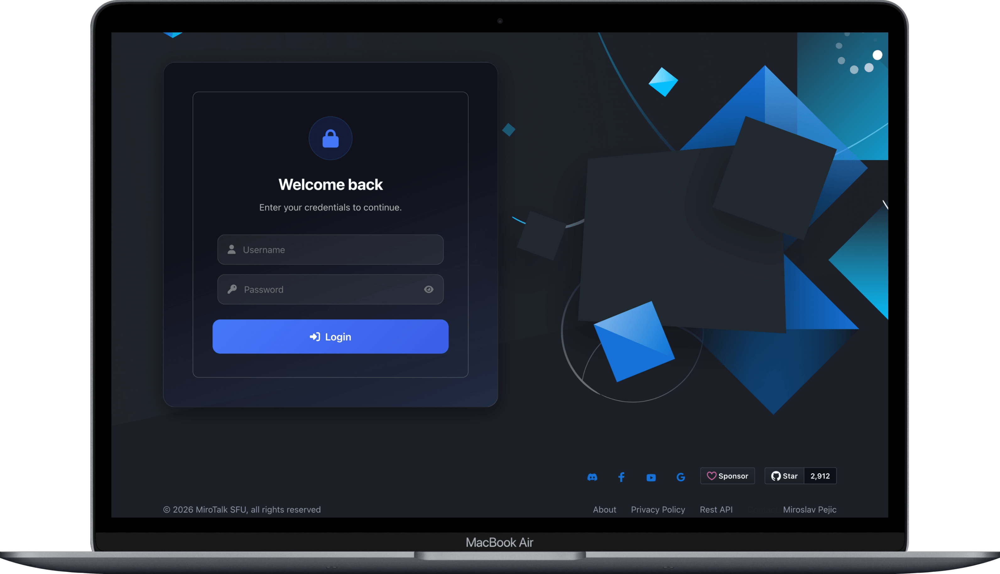
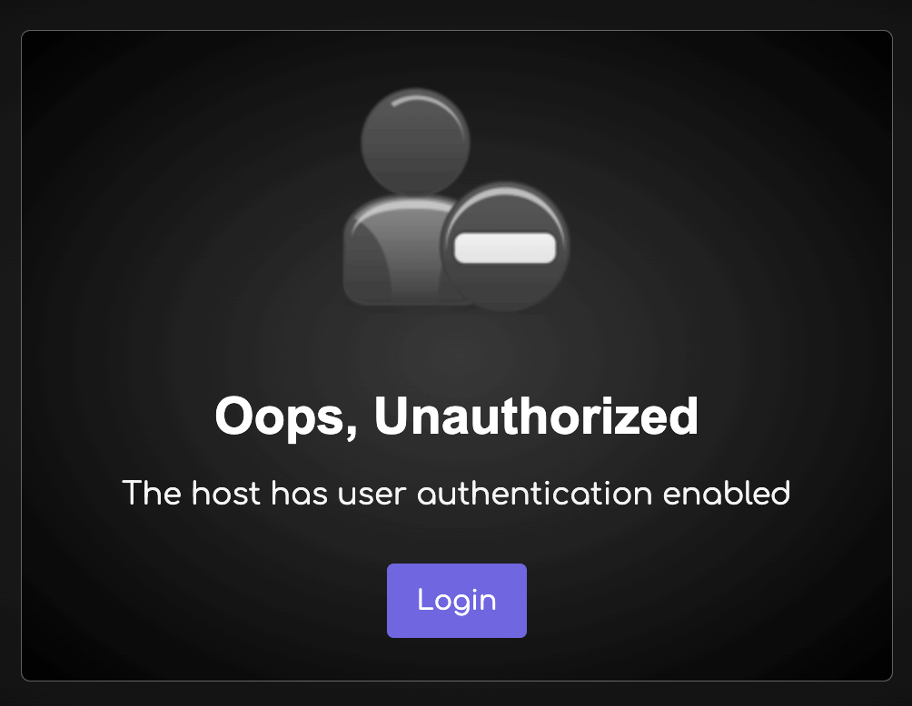

# Host Protection



Host protection lets you secure video conferencing rooms by requiring authentication before creating or joining a room.

## Configuration

Set these parameters in your `.env` file:

| Variable | Default | Description |
| :--- | :--- | :--- |
| `HOST_PROTECTED` | `false` | Require the host to provide valid credentials during room initialization |
| `HOST_USER_AUTH` | `false` | Require participants to authenticate before joining |
| `HOST_USERS` | — | Define host users in the format: `username:password:displayName:allowedRooms` (comma-separated rooms, or `*` for all) |

**Example:**

```bash
HOST_PROTECTED=true
HOST_USER_AUTH=false
HOST_USERS="alice:<strong-password>:Alice:*|bob:<another-strong-password>:Bob:room1,room2"
```

### `HOST_USERS` format

`HOST_USERS` uses the same format as [MiroTalk P2P](../mirotalk-p2p/host-protection.md). Separate users with `|`, fields with `:`, and rooms with `,`.

| Field | Required | Description |
| :--- | :--- | :--- |
| `username` | Yes | Login username |
| `password` | Yes | Login password (1–36 characters) |
| `displayName` | No | Name used in the room. Users cannot change it. If omitted, `HOST_PROTECTED` uses the login username; otherwise users choose their own name |
| `allowedRooms` | No | Rooms this login can open or join, comma-separated. `*` (default) allows all rooms |

If a value contains `:`, `|` or `,`, use the JSON format instead:

```bash
HOST_USERS='[{"username":"alice","password":"<strong-password>","displayname":"Alice","allowed_rooms":["*"]},{"username":"bob","password":"<another-strong-password>","displayname":"Bob","allowed_rooms":["room1","room2"]}]'
```

!!! warning "Use strong credentials"
    Use your own unique, strong credentials. The server refuses to start with well-known defaults such as `admin/admin`, `guest/guest` or `username/password`.

!!! note
    `HOST_USERS` is required when `HOST_PROTECTED` or `HOST_USER_AUTH` is `true`, unless OIDC or `HOST_USERS_FROM_DB=true` is used.

---

## How It Works

When `HOST_PROTECTED` is `true`:

1. The host must log in with a username and password.
2. On success, the host's IP is saved as an authenticated IP.
3. The host can now create rooms, join rooms, and share links.
4. Guests can join freely while the host is active.
5. When the host leaves the room or closes the browser, their IP is removed — preventing further unauthorized access.
6. The host must log in again to regain access.

When `HOST_USER_AUTH` is also `true`, **participants** are additionally required to authenticate before joining.

---

## Token

After authentication, a JWT token is stored in `window.sessionStorage.peer_token`. The default expiration is **1 hour**, configurable via `JWT_EXPIRATION` in the `.env` file. Tokens can also be generated through the [REST API](./api.md).

---

## Room Initialization

Bypass the login page and join a room directly with a token:

```
https://YOUR-DOMAIN-NAME/join/?room=test&token=TOKEN
```

---

## Participant Room Entry

### With `HOST_PROTECTED` enabled

After the host authenticates, participants can join using the room path:

```
https://YOUR-DOMAIN-NAME/join/test
```

Or with additional query parameters:

```
https://YOUR-DOMAIN-NAME/join/?room=test&roomPassword=0&name=mirotalksfu&audio=0&video=0&screen=0&notify=0
```

---

### With `HOST_USER_AUTH` enabled

Participants are prompted to log in before accessing the room:



To skip the login prompt, pass a valid token in the URL:

```
https://YOUR-DOMAIN-NAME/join/?room=test&token=TOKEN
```

Or with additional participant settings:

```
https://YOUR-DOMAIN-NAME/join/?room=test&name=mirotalk&audio=0&video=0&screen=0&notify=0&token=TOKEN
```

---

## Presenters

Set these parameters in your `.env` file:

| Variable | Default | Description |
| :--- | :--- | :--- |
| `PRESENTERS` | — | Presenter login usernames, or OIDC verified emails / `sub` values (comma-separated) |
| `PRESENTER_JOIN_FIRST` | `true` | The first participant to join the room becomes presenter |

**Example:**

```bash
PRESENTERS=alice,presenter@example.com
PRESENTER_JOIN_FIRST=true
```

`PRESENTERS` only matches identities the server can verify. It **never** matches the name someone types in the join form. Otherwise, anyone could type a listed name and become presenter.

| Setup | How to make someone presenter |
| :--- | :--- |
| **No authentication** | `PRESENTERS` has no effect. Use `PRESENTER_JOIN_FIRST=true`, so the first participant to join the room becomes presenter |
| **Host login** (`HOST_PROTECTED` or `HOST_USER_AUTH`) | Add the **login username** to `PRESENTERS`, not the display name. In `HOST_USERS="alice:<pass>:Alice:*"`, the login username is `alice` |
| **OIDC** | Add the verified **email** or the **`sub`** claim to `PRESENTERS` |
| **JWT token** | Join with a token created with `presenter: true` (see the [REST API](./api.md)) |

!!! tip
    To make a specific person presenter every time, use host login, OIDC or a token. For open rooms without login, `PRESENTER_JOIN_FIRST=true` is the simplest choice.

### Moderator in open rooms

To keep rooms open to everyone and still have a fixed moderator, use a presenter token. Guests join without logging in. The server checks the moderator's token before granting presenter rights.

```bash
HOST_PROTECTED=false
HOST_USER_AUTH=false
HOST_USERS="mod:<strong-password>:Moderator:*"
PRESENTER_JOIN_FIRST=false
API_KEY_SECRET=<your-secret>
API_ALLOW_TOKEN=true
```

Generate the token with the [REST API](./api.md):

```bash
curl -X POST "https://YOUR-DOMAIN-NAME/api/v1/token" \
  -H "authorization: <your-secret>" \
  -H "Content-Type: application/json" \
  -d '{"username":"mod","password":"<strong-password>","presenter":true,"expire":"8h"}'
```

Then the moderator joins with:

```
https://YOUR-DOMAIN-NAME/join/?room=myroom&name=Moderator&token=TOKEN
```

!!! warning
    Keep the token link private, because anyone who has it becomes presenter until the token expires. If the moderator is already in the room as a guest, they must leave and rejoin with the token link.

---
