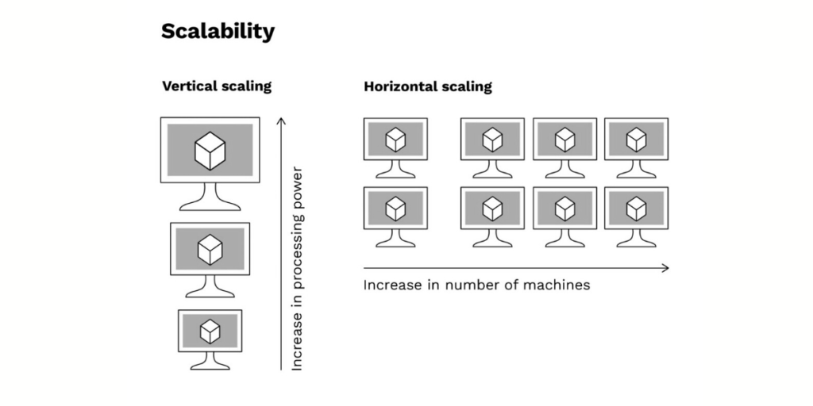

# MiroTalk SFU - Vertical & Horizontal Scaling



## Overview

Scale MiroTalk SFU to **handle 100-1000+ concurrent users** across multiple rooms.

**Four options:**

1.  **Vertical Scaling:** Single powerful server (50-100+ users)
2.  **Horizontal Scaling:** Multiple servers + Load Balancer (100-1000+ users)
3.  **Multi-Worker Rooms:** One big room spread over several CPU cores (30-200+ users in one room)
4.  **Built-in Cluster with Redis:** Automatic room placement across many servers (1000+ users)

The following built-in scaling options are **optional and disabled by default**. They are independent: enable one, the other, or both.

| Option | Solves | Extra infrastructure | Environment switch |
| ------ | ------ | -------------------- | ------------------ |
| **3. Multi-Worker Rooms** | One big room limited to a single CPU core | None | `SCALING_MULTI_WORKER_ROOMS=true` |
| **4. Built-in Redis Cluster** | Many rooms across many servers, with automatic placement | Redis | `SCALING_CLUSTER=true` |

!!! tip "Which one should I pick?"

    - **Up to ~800 users:** Option 1 (one server). Add **Option 3** if a single room has more than ~30 participants.
    - **Several servers, simple setup:** Option 2. No Redis, and one hostname for everything.
    - **Several servers, growing or auto-scaling:** Option 4. Rooms go to the least loaded server, and servers can be added or removed without moving rooms.
    - **Large single rooms on several servers:** Option 4 + Option 3.

    Options 2 and 4 give the **same total capacity** (~800 users per 8-core server). Option 4 places and manages rooms better; it doesn't add capacity.

## Option 1: Vertical Scaling

**Best for:** 50-100+ concurrent users

### Configuration

```bash
SFU_ANNOUNCED_IP=YOUR_PUBLIC_IP
SFU_SERVER=true
SFU_NUM_WORKERS=8
SFU_MIN_PORT=40000
SFU_MAX_PORT=49999
```

### Capacity

-  **4-core server:** ~400 users (4 workers × ~100 users)
-  **8-core server:** ~800 users (8 workers × ~100 users)
-  **16-core server:** ~1600 users (16 workers × ~100 users)

**Formula:** `numWorkers × ~100 users = capacity`

!!! info "Note"

    Official mediasoup docs state ~500 consumers per worker. In a typical room with N users sending audio+video, each user consumes 2×(N-1) streams. For 4-person room = 24 consumers total, so one worker can handle many rooms simultaneously.

## Option 2: Horizontal Scaling + Load Balancer

**Best for:** 100-1000+ concurrent users across multiple rooms

### Architecture

```
                Load Balancer (Nginx/HAProxy)
                    lb.yourdomain.com
                           |
        ┌──────────────────┼──────────────────┐
        |                  |                  |
     SFU #1             SFU #2             SFU #3
    1.1.1.1            2.2.2.2            3.3.3.3
    ~800 users         ~800 users         ~800 users
```

**Key:** Users in the same room stay on the same server (sticky sessions).

### Step 1: Configure Each SFU Server

```bash
# Server 1
SFU_ANNOUNCED_IP=1.1.1.1
SFU_SERVER=true
SFU_NUM_WORKERS=8
SFU_MIN_PORT=40000
SFU_MAX_PORT=49999

# Server 2
SFU_ANNOUNCED_IP=2.2.2.2
SFU_SERVER=true
# ...

# Server 3
SFU_ANNOUNCED_IP=3.3.3.3
SFU_SERVER=true
# ...
```

### Step 2: Setup Load Balancer

**Nginx Configuration:**

```nginx
# /etc/nginx/sites-available/mirotalk-lb

# Add these maps in the http context, outside the server block.
map $uri $room_from_path {
    ~^/join/(?<r>[^/]+) $r;
    default "";
}

map $arg_room $room_key {
    ""      $room_from_path;
    default $arg_room;
}

map $room_key $lb_key {
    ""      $remote_addr;
    default $room_key;
}

upstream mirotalk_backend {
    hash $lb_key consistent;

    server 1.1.1.1:3010 max_fails=3 fail_timeout=30s;
    server 2.2.2.2:3010 max_fails=3 fail_timeout=30s;
    server 3.3.3.3:3010 max_fails=3 fail_timeout=30s;
}

server {
    listen 443 ssl http2;
    server_name sfu.yourdomain.com;

    ssl_certificate /path/to/cert.pem;
    ssl_certificate_key /path/to/key.pem;

    location / {
        proxy_pass http://mirotalk_backend;
        proxy_http_version 1.1;

        # WebSocket support
        proxy_set_header Upgrade $http_upgrade;
        proxy_set_header Connection "upgrade";
        proxy_set_header Host $host;
        proxy_set_header X-Real-IP $remote_addr;

        # Keep connections open for WebRTC signaling
        proxy_read_timeout 600s;
        proxy_send_timeout 600s;
    }
}
```

**What Happens Here**

The maps use the `room` query parameter when present, or extract the room ID from a `/join/ROOM` path. The SFU client also sends the room ID as `room` on the Socket.IO handshake (`/socket.io/`), so the page request and its WebSocket connection use the same consistent-hash key. Requests without a room ID, such as assets and the home page, fall back to the client's IP address. If a server fails, only a few room keys are reassigned to other nodes.

**HAProxy Configuration:**

```haproxy
# /etc/haproxy/haproxy.cfg

frontend sfu_frontend
    bind *:443 ssl crt /path/to/cert.pem
    http-request set-var(txn.room) url_param(room)
    http-request set-var(txn.room) path,field(3,/) if !{ var(txn.room) -m found } { path_beg /join/ }
    http-request set-var(txn.room) src if !{ var(txn.room) -m found }
    default_backend sfu_backend

backend sfu_backend
    balance hash var(txn.room)
    hash-type consistent

    option http-server-close
    option forwardfor

    server sfu1 1.1.1.1:3010 check ssl verify none
    server sfu2 2.2.2.2:3010 check ssl verify none
    server sfu3 3.3.3.3:3010 check ssl verify none
```

**What Happens Here**

HAProxy first uses the `room` query parameter, then falls back to the room ID in a `/join/ROOM` path. For requests without a room ID, it uses the client's source IP. The SFU client sends the room ID as `room` on the Socket.IO handshake, keeping the page and WebSocket on the same backend. `hash-type consistent` limits room reassignment if a server goes down.

!!! warning "Use an updated SFU client"

    Room affinity depends on the client sending `room` on the Socket.IO handshake and on the waiting-room and widget room checks (`/isRoomActive?room=ROOM`, `/isWidgetRoomActive?room=ROOM`). Deploy an SFU version that includes this change and have users refresh cached clients; older clients may open a WebSocket without the room ID, so the load balancer cannot reliably route it to the room's server.

### Step 3: Configure Firewall

```bash
# Check the firewall Status: (active/inactive) If active then allow traffic
ufw status

# On each SFU server
sudo ufw allow 3010/tcp
sudo ufw allow 40000:49999/udp

# On load balancer
sudo ufw allow 80/tcp
sudo ufw allow 443/tcp
```

### Step 4: Test

```bash
# Check individual servers
curl https://1.1.1.1:3010/
curl https://2.2.2.2:3010/
curl https://3.3.3.3:3010/

# Check load balancer
curl https://sfu.yourdomain.com/
```

## Deploy 3-Node Cluster in 30 Minutes

**On each server (1.1.1.1, 2.2.2.2, 3.3.3.3)** just follow the self-hosting guide [here](./self-hosting.md)

**On load balancer server:**

```bash
# Install Nginx
sudo apt update
sudo apt install -y nginx certbot python3-certbot-nginx

# Get SSL cert
sudo certbot --nginx -d sfu.yourdomain.com

# Configure (use Nginx config above)
sudo nano /etc/nginx/sites-available/mirotalk-lb
sudo ln -s /etc/nginx/sites-available/mirotalk-lb /etc/nginx/sites-enabled/
sudo nginx -t
sudo systemctl restart nginx
```

**Done!** Access: `https://sfu.yourdomain.com`

---

## Option 3: Multi-Worker Rooms

**Best for:** large meetings, webinars and classes (30-200+ participants in the same room) on a single server.

By default, every room lives on **one mediasoup worker**, so a single room can use only **one CPU core**,
no matter how many cores the server has. With multi-worker rooms, a room spreads over several workers.

### Configuration

```bash
SFU_NUM_WORKERS=8
SCALING_MULTI_WORKER_ROOMS=true
SCALING_MAX_PEERS_PER_ROUTER=20
```

### What Happens

```text
                        Room "webinar" (60 participants)
   ┌───────────────────────────┬───────────────────────────┬───────────────────────────┐
   Worker #1 (main router)      Worker #2 (overflow)        Worker #3 (overflow)
   peers 1-20                   peers 21-40                 peers 41-60
   active speaker detection     ▲                           ▲
   WHIP ingest                  └──── pipeToRouter ─────────┘  (local 127.0.0.1, on demand)
```

1. The first `SCALING_MAX_PEERS_PER_ROUTER` participants join the room's main router.
2. When it is full, the room opens a new router on the **least loaded worker** it does not use yet.
3. A participant's audio/video is **piped** (mediasoup `pipeToRouter`) only to the routers that have viewers for it, the first time someone there consumes it. The piped copy keeps the original id, so nothing changes for clients.
4. Data channels (chat, file sharing) are piped the same way.
5. Active speaker/audio level detection stays on the main router (audio is piped there).
6. When the last participant of an overflow router leaves, that router is closed.
7. New rooms are created on the least loaded worker instead of round-robin.

### Tuning `SCALING_MAX_PEERS_PER_ROUTER`

| Value | Effect |
| ----- | ------ |
| 10-15 | Spreads early: best for video-heavy rooms, with more piping between workers |
| 20 | Default: good balance |
| 40+ | Spreads late: best for audio-only or webinar rooms with few active cameras |

!!! info "Note"

    Mediasoup recommends about 500 consumers per worker. A participant receiving audio and video from N others uses 2×N consumers, so a router with 20 participants in a 60-person room can already handle about 2400 consumers. Splitting big rooms over several cores helps distribute that load.

## Option 4: Built-in Cluster with Redis

**Best for:** 1000+ concurrent users across many rooms, auto-scaling, and adding or removing servers without changing the load balancer.

Compared to Option 2 (room hash on the load balancer), SFU nodes coordinate through Redis:

- New rooms go to the **least loaded node** (not a hash), and full nodes can be excluded.
- Nodes can be added or removed at any time, with no room reshuffling.
- A dead node's rooms are taken over by the remaining nodes.
- The REST API (`/stats`, `/meetings`, `/activeRooms`, `DELETE /meeting`) works **cluster-wide** from any node.
- A host login (host protection) on one node is valid on every node.

!!! tip "Kubernetes"

    Prefer Kubernetes? The [k3s deployment guide](kubernetes.md) runs this cluster mode on bare-metal / VDS servers with ready-made manifests (Traefik, Let's Encrypt, Redis, one SFU pod per node).

### Architecture

```text
                  https://meet.yourdomain.com  (entry: any LB, round-robin or DNS)
                                  |
          ┌───────────────────────┼───────────────────────┐
          |                       |                       |
       SFU #1                  SFU #2                  SFU #3
 sfu1.yourdomain.com     sfu2.yourdomain.com     sfu3.yourdomain.com
     1.1.1.1                 2.2.2.2                 3.3.3.3
          |                       |                       |
          └──────────── Redis (private network) ──────────┘
```

**Key:** every room is hosted entirely by one node. Every node has its **own public hostname**, and the entry URL just picks any node.

### What Happens

1. A user opens `https://meet.yourdomain.com/join/my-room`. The load balancer sends the request to any node, for example SFU #1.
2. SFU #1 asks Redis which node owns `my-room`:
    - **Nobody yet:** the room is reserved on the least loaded alive node, for example SFU #2.
    - **Owned by an alive node:** that node is used.
3. If the room is not local, SFU #1 answers `302 → https://sfu2.yourdomain.com/join/my-room` (path and query string are kept).
4. Everyone joining `my-room` from any entry lands on SFU #2, which creates and hosts the room.
5. Every node sends a heartbeat to Redis every few seconds with its load and rooms. A node that stops sending it is considered dead after `SCALING_NODE_TTL` seconds, and its rooms can be placed elsewhere.
6. Breakout rooms always stay on the node of their main room.

Routed entry points: `/join/ROOM`, `/join?room=ROOM`, `/ROOM`, `/whoAreYou/ROOM` and WHIP `POST /whip/ROOM` (307).

### Step 1: Run Redis (private)

On a server reachable **only** by the SFU nodes (private network or firewall):

```bash
docker run -d --name mirotalk-redis --restart unless-stopped \
  -p 10.0.0.10:6379:6379 \
  redis:7-alpine redis-server --requirepass 'CHANGE_ME_STRONG_PASSWORD' --save '' --appendonly no
```

Redis only holds short-lived coordination data (nodes, room owners, host logins), so persistence is not needed.
A managed Redis or Valkey works too. Redis **Cluster mode** is not supported; use a single Redis endpoint.

!!! warning "Warning"

    Keep Redis private. Anyone who can write to it can redirect rooms or end meetings.

### Step 2: Configure Each SFU Node

Use the same `.env` on every node, except the lines marked **per node**:

```bash
# --- per node ---
SFU_ANNOUNCED_IP=1.1.1.1                          # This node's public IP
SCALING_NODE_ID=sfu1                              # Unique id
SCALING_NODE_URL=https://sfu1.yourdomain.com      # This node's own public URL

# --- same on every node ---
SFU_SERVER=true
SFU_NUM_WORKERS=8
SFU_MIN_PORT=40000
SFU_MAX_PORT=49999
SERVER_HOST_URL=https://meet.yourdomain.com       # Public entry URL

SCALING_CLUSTER=true
SCALING_REDIS_URL=redis://:CHANGE_ME_STRONG_PASSWORD@10.0.0.10:6379
SCALING_MAX_PEERS_PER_NODE=0                      # e.g. 800 to stop placing new rooms on a full node (0 = unlimited)

# Optional, combine with Option 3 for big rooms
SCALING_MULTI_WORKER_ROOMS=true

# Shared secrets: MUST be identical on all nodes
JWT_KEY=...
API_KEY_SECRET=...
# HOST_PROTECTED / HOST_USERS / PRESENTERS / OIDC_* ... identical as well
```

Use `rediss://` for TLS connections to managed Redis.

### Step 3: Entry Load Balancer + Node Hostnames

Each node must be reachable directly on its own hostname with a valid TLS certificate (`sfuN.yourdomain.com`):
either expose each node with its own Nginx/Caddy and certificate, or add one `server` block per node on the load balancer.

The entry hostname needs **no room stickiness**. Any round-robin works:

```nginx
# /etc/nginx/sites-available/mirotalk-cluster

upstream mirotalk_nodes {
    server 1.1.1.1:3010 max_fails=3 fail_timeout=30s;
    server 2.2.2.2:3010 max_fails=3 fail_timeout=30s;
    server 3.3.3.3:3010 max_fails=3 fail_timeout=30s;
}

# Entry: any node, the nodes redirect to the room's node
server {
    listen 443 ssl http2;
    server_name meet.yourdomain.com;
    ssl_certificate     /etc/letsencrypt/live/meet.yourdomain.com/fullchain.pem;
    ssl_certificate_key /etc/letsencrypt/live/meet.yourdomain.com/privkey.pem;

    location / {
        proxy_pass https://mirotalk_nodes;
        proxy_http_version 1.1;
        proxy_set_header Upgrade $http_upgrade;
        proxy_set_header Connection "upgrade";
        proxy_set_header Host $host;
        proxy_set_header X-Forwarded-For $proxy_add_x_forwarded_for;
        proxy_read_timeout 600s;
        proxy_send_timeout 600s;
    }
}

# One block per node (repeat for sfu2 / sfu3)
server {
    listen 443 ssl http2;
    server_name sfu1.yourdomain.com;
    ssl_certificate     /etc/letsencrypt/live/sfu1.yourdomain.com/fullchain.pem;
    ssl_certificate_key /etc/letsencrypt/live/sfu1.yourdomain.com/privkey.pem;

    location / {
        proxy_pass https://1.1.1.1:3010;
        proxy_http_version 1.1;
        proxy_set_header Upgrade $http_upgrade;
        proxy_set_header Connection "upgrade";
        proxy_set_header Host $host;
        proxy_set_header X-Forwarded-For $proxy_add_x_forwarded_for;
        proxy_read_timeout 600s;
        proxy_send_timeout 600s;
    }
}
```

Set `TRUST_PROXY=true` on the nodes when they sit behind a proxy (correct client IPs for rate limits and host protection).

!!! tip "Tip"

    You can keep the Option 2 room-hash load balancer as the entry instead of round-robin. The cluster then redirects only when the hash picks a node that does not own the room (for example after adding or removing a node).

### Step 4: Configure Firewall

```bash
# On each SFU node
sudo ufw allow 3010/tcp                               # From the load balancer / proxy
sudo ufw allow 40000:49999/udp                        # WebRTC media (public)
sudo ufw allow 40000:49999/tcp                        # WebRTC TCP fallback (public)

# On the Redis server: only the SFU nodes
sudo ufw allow from 1.1.1.1 to any port 6379 proto tcp
sudo ufw allow from 2.2.2.2 to any port 6379 proto tcp
sudo ufw allow from 3.3.3.3 to any port 6379 proto tcp
```

### Step 5: Test

```bash
# Every node logs on startup:
#   [Scaling] Cluster node started { node_id: 'sfu1', node_url: 'https://sfu1.yourdomain.com' }

# Nodes registered in Redis
redis-cli -a 'CHANGE_ME_STRONG_PASSWORD' -h 10.0.0.10 smembers mirotalksfu:nodes

# A room is placed and every node redirects to it
curl -sk -o /dev/null -w "%{http_code} %{redirect_url}\n" https://meet.yourdomain.com/join/test-room
redis-cli -a 'CHANGE_ME_STRONG_PASSWORD' -h 10.0.0.10 get mirotalksfu:room:test-room

# Cluster-wide stats from any node
curl -s -H "authorization: YOUR_API_KEY_SECRET" https://meet.yourdomain.com/api/v1/stats
```

### Feature Notes

| Feature | Behavior in cluster mode |
| ------- | ------------------------- |
| Host protection | Logins/logouts are replicated to every node through Redis. |
| OIDC | Set `OIDC_BASE_URL_DYNAMIC=true` and list the entry URL and every node URL in `OIDC_ALLOWED_DYNAMIC_BASE_URLS`. Register each node's `/auth/callback` URL in your identity provider. The provider's SSO session signs users in on the node they land on. |
| REST API | `GET /stats`, `/meetings`, `/activeRooms` include all nodes. `DELETE /meeting/ROOM` is forwarded to the room's node. |
| WHIP (OBS, FFmpeg) | `POST /api/v1/whip` returns the URL of the node hosting the room; use it. A `POST /whip/ROOM` to another node gets a `307`. |
| Recording | Saved on the node hosting the room. Set `S3_ENABLED=true` and `RECORDING_UPLOAD_TO_S3=true` to collect all recordings in one bucket. |
| RTMP streaming | Runs on the node hosting the room. |
| Breakout rooms | Always placed on the node of their main room. |
| Rate limits | Applied per node. |
| Invite links copied in the room | They use the node hostname (`sfuN.yourdomain.com/join/ROOM`). They work while that node is up; from another node they redirect correctly. |

### Failure Behavior

| Event | What happens |
| ----- | ------------ |
| Node restart / deploy | Graceful shutdown (`SIGTERM`) leaves the cluster first, so new rooms go to the other nodes right away. Participants of that node rejoin through the entry URL. |
| Node crash | After `SCALING_NODE_TTL` seconds (default 15) the node is considered dead. Rejoining `meet.yourdomain.com/join/ROOM` recreates the room on an alive node. |
| Redis unreachable | Nodes keep working and serve every request locally (standalone mode) until Redis is back. Meanwhile, two nodes could host a room with the same name separately. |

### Environment Reference

| Variable | Default | Description |
| -------- | ------- | ----------- |
| `SCALING_MULTI_WORKER_ROOMS` | `false` | Option 3: spread a single room over several mediasoup workers |
| `SCALING_MAX_PEERS_PER_ROUTER` | `20` | Peers on one worker before the room spills to another one |
| `SCALING_CLUSTER` | `false` | Option 4: multi-node cluster through Redis |
| `SCALING_REDIS_URL` | `redis://localhost:6379` | Redis URL (`redis://:password@host:6379`, `rediss://` for TLS) |
| `SCALING_NODE_ID` | `hostname-pid` | Unique node id (set a stable one) |
| `SCALING_NODE_URL` | _(required)_ | Public URL of this node, e.g. `https://sfu1.yourdomain.com` |
| `SCALING_KEY_PREFIX` | `mirotalksfu` | Redis keys/channels prefix (run several clusters on one Redis) |
| `SCALING_HEARTBEAT_INTERVAL` | `5` | Seconds between node heartbeats |
| `SCALING_NODE_TTL` | `15` | Seconds without heartbeat before a node is considered dead |
| `SCALING_ROOM_RESERVATION_TTL` | `600` | Seconds a placed room stays reserved before its first participant joins |
| `SCALING_MAX_PEERS_PER_NODE` | `0` | Stop placing new rooms on this node above this many peers (0 = unlimited) |

### Redis Keys (for Monitoring)

| Key / channel | Content |
| ------------- | ------- |
| `mirotalksfu:nodes` | Set of node ids |
| `mirotalksfu:node:<id>` | JSON: url, peers, rooms (expires after `SCALING_NODE_TTL`) |
| `mirotalksfu:room:<room>` | Id of the node hosting or reserved for the room |
| `mirotalksfu:set:hostauth` | Host protection logins shared by all nodes |
| `mirotalksfu:rpc:<id>` (pub/sub) | Requests between nodes (meetings list, end meeting) |

---

## Capacity Planning

| Setup | Concurrent Users | Cost/Month (€) |
|-------|------------------|----------------|
| 1× 8-core, 16GB | ~800 | €14-20 |
| 3× 8-core, 16GB + LB | ~2400 | €47-65 |
| 5× 8-core, 16GB + LB | ~4000 | €75-105 |

### With Built-in Scaling (Options 3 & 4)

| Setup | Concurrent users | Largest single room |
| ----- | ---------------- | ------------------- |
| 1× 8-core, default | ~800 | ~1 core worth |
| 1× 8-core, Option 3 | ~800 | Up to all 8 cores |
| 3× 8-core, Option 4 + Redis | ~2400 | ~1 core worth |
| 3× 8-core, Option 3 + Option 4 + Redis | ~2400 | Up to 8 cores (one server) |

A single room is always hosted by one server. Rooms bigger than one server (cascading between servers) are not supported yet.

### Provider Comparison (8 vCores, 16GB RAM)

| Provider | Plan | CPU | RAM | Storage | Traffic | Price/Month |
|----------|------|-----|-----|---------|---------|-------------|
| **[Hetzner](https://hetzner.cloud/)** | CPX41 | 8 vCPU | 16 GB | 320 GB SSD | 20 TB | **€19.99** |
| **[Netcup](https://www.netcup.com/en/?ref=309627)** | RS 2000 G11 | 8 vCores | 16 GB | 512 GB SSD | Unlimited | **€17.99** |
| **[Contabo](https://www.dpbolvw.net/click-101027391-14462707)** | VPS 20 | 8 vCores | 24 GB | 200 GB SSD | Unlimited | **€14.00** |

### Load Balancer Options

| Option | Cost/Month | Notes |
|--------|------------|-------|
| Small VPS (Nginx) | €5-10 | 2 vCores, 4GB RAM sufficient |
| Hetzner LB | €5.39 | Managed, auto-scaling |
| Netcup VPS 500 G11 | €4.88 | 4 vCores, 4GB RAM |


### Total Cost Examples


**Premium Setup [Hetzner](https://hetzner.cloud/):**

-  3× Hetzner CPX41 (€19.99) = €60
-  1× Hetzner LB = €5.39
-  **Total: ~€65/month** for ~2400 users
-  ⚡ **Best Performance:** Hetzner - Premium network quality, best for production with high traffic

---


**Balanced Setup [Netcup](https://www.netcup.com/en/?ref=309627):**

-  3× Netcup RS 2000 (€17.99) = €54
-  1× Netcup VPS 500 (LB) = €4.88
-  **Total: ~€59/month** for ~2400 users
-  🏆 **Best Overall:** Netcup - Perfect balance of price, performance, and reliability

---


**Budget Setup [Contabo](https://www.dpbolvw.net/click-101027391-14462707):**

-  3× Contabo VPS 20 (€14.00) = €42
-  1× Netcup VPS 500 (LB) = €4.88
-  **Total: ~€47/month** for ~2400 users
-  💰 **Lowest Cost:** Contabo - Good for testing or budget-conscious deployments, but slower network

---

**Bandwidth per user:**

-  Audio only: ~50–100 kbps
-  SD video: ~300–600 kbps per stream
-  HD video (720p): ~1–1.5 Mbps per stream
-  Full HD (1080p): ~2–3 Mbps per stream

---

**Need help?**

Join our [community forum]({{ links.discord }}) and **Happy Scaling!** 🚀
