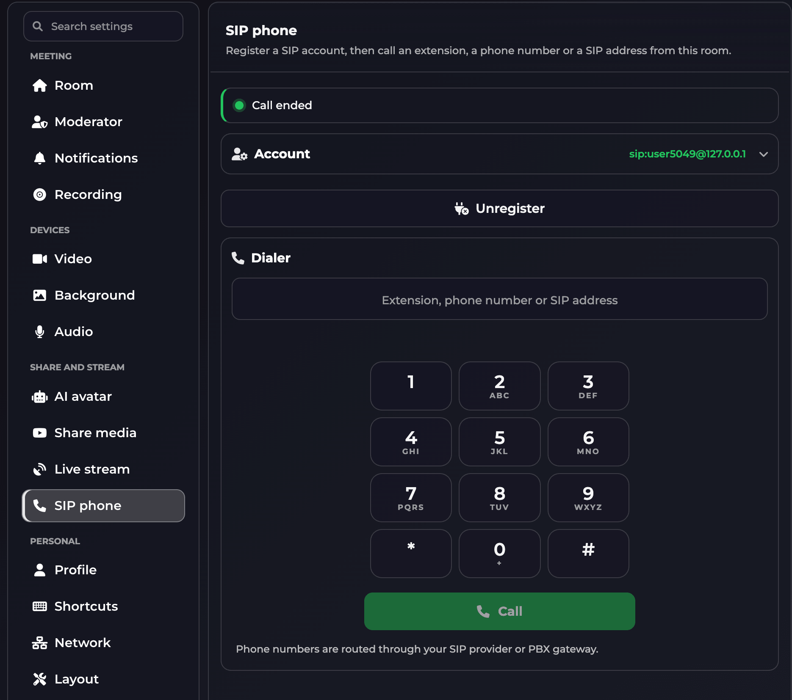

# 📞 SIP phone (Experimental)

Use the built-in **SIP phone** panel in MiroTalk SFU to register a SIP account from inside a room, then call an **extension**, a **phone number** or a **SIP address**.

This feature is currently marked as **experimental** and is intended as a practical MVP for SIP interop testing.



---

## 🧪 Experimental SIP demo (Kamailio)

A minimal, self-contained SIP demo is available in [sip/](https://github.com/miroslavpejic85/mirotalksfu/tree/main/sip):

- Kamailio in Docker (`REGISTER` + `INVITE` routing)
- Simple Node.js web SIP client example

Quick start:

```bash
cd sip
chmod +x run.sh
./run.sh
```

Open <http://localhost:8088>. Full instructions: [sip/README.md](https://github.com/miroslavpejic85/mirotalksfu/blob/main/sip/README.md).

You can also test the in-room SIP phone MVP directly in MiroTalk SFU:

1. Start MiroTalk SFU normally.
2. Start the SIP stack (`./sip/run.sh`).
3. Join a room with two browsers/users.
4. Open **Settings → SIP phone**, register random users, and call each other.

The in-room SIP phone uses this demo server by default (`ws://<host>:5066`, SIP domain `<host>`).

!!! info "WebSocket contact aliasing"

    The demo Kamailio config aliases WebSocket contacts (`add_contact_alias` / `handle_ruri_alias`) so in-dialog `ACK`/`BYE`/re-`INVITE` requests reach browser clients, which advertise unroutable Contacts (e.g. `*.invalid` / `192.0.2.x`). Apply the same approach on your own Kamailio/OpenSIPS setup if calls connect but hang-up or media renegotiation fails.

---

## Compatibility

The SIP phone works with the bundled demo and is designed to be compatible with **most SIP servers that expose WSS (WebSocket Secure)** transport (for example Kamailio, Asterisk, FreeSWITCH, OpenSIPS, and similar SIP platforms configured for WebRTC clients).

For non-demo deployments, ensure your SIP server provides:

- `wss://` SIP WebSocket endpoint reachable from browsers
- Correct SIP domain/realm for registration
- WebRTC-compatible SIP profile/transports
- DTLS-SRTP / ICE / NAT handling suitable for browser endpoints
- A PSTN trunk (SIP provider or PBX gateway) if you want to call real phone numbers

!!! warning "Experimental scope"

    SIP interoperability can vary by server configuration, NAT topology, auth policy, and codec/transcoding rules. Validate your full call flow in your own environment before production usage.

---

## SIP phone panel

The panel is organized in a few sections:

- **Status bar**: shows the current state (idle, registering, registered, incoming, in call, error) with a color indicator and a live **call timer** during active calls.
- **Incoming call banner**: shows the caller with **Accept** / **Reject** buttons (a toast notification is also shown).
- **Account**: SIP registration settings. The card collapses automatically after a successful registration and shows the registered identity (`sip:user@domain`); fields are locked while registered.
- **Dialer**: call target input, keypad, call controls and recent numbers.

### Account fields

| Field | Description | Example |
| --- | --- | --- |
| WS server | SIP WebSocket endpoint used by the browser SIP stack. | `ws://127.0.0.1:5066` or `wss://sip.example.com:7443` |
| SIP domain | SIP realm/domain sent in SIP registration and INVITE flows. | `127.0.0.1` |
| SIP username | SIP account/extension to register. Use the inline buttons to generate a **random user** or **copy** the current one. | `user8165` |
| Auth username | Authentication username (optional, defaults to SIP username). | `user8165` |
| SIP password | Optional in open/local test setups, required when server auth is enabled. | `••••••••` |
| Contact IP compatibility hack | Toggles SIP.js `hackIpInContact` for better interoperability across SIP servers. | on/off |

**Advanced compatibility** (collapsible):

| Field | Description | Example |
| --- | --- | --- |
| Display name | Optional caller display name. | `Alice` |
| Outbound proxy / route set | Optional outbound proxy or route set. | `sip:proxy.example.com;lr` |
| Phone number gateway | Domain used for phone-number calls (defaults to SIP domain). Extensions keep using the SIP domain. | `pstn.provider.com` |
| Register expires (s) | Registration expiry in seconds. | `600` |

Use **Register / Unregister** to control the SIP registration lifecycle.

### Dialer

The **call target** input accepts an extension, a phone number or a SIP address. The detected type and the resulting SIP URI are previewed under the input:

| You type | Detected as | Called URI |
| --- | --- | --- |
| `1001`, `alice` | Extension | `sip:1001@<SIP domain>` |
| `+1 (555) 123-4567`, `0039 06 1234 5678` | Phone number | `sip:+15551234567@<phone number gateway or SIP domain>` |
| `tel:+15551234567` | Phone number | same as above |
| `bob@example.org`, `sip:bob@example.org` | SIP address | used as-is |

- Phone-number formatting (spaces, dashes, dots, parentheses) is stripped.
- Values starting with `+` or with **7+ digits** are treated as phone numbers; shorter ones as extensions.
- Invalid targets (e.g. `12+34`) are rejected.

Dialer controls:

- **Keypad**: tap digits, `*` and `#`; **hold `0`** to insert `+`.
- **Backspace**: delete the last character; **hold** to clear the input.
- **Enter** in the target input places the call.
- **Call / Mute / Hang up**: start a call, mute/unmute your microphone, and end the call.
- **DTMF**: during an active call, the keypad (or keyboard keys `0-9`, `*`, `#`) sends DTMF tones (RTP, with SIP `INFO` fallback).
- **Recent**: the last 6 dialed targets are shown as quick-dial chips.

!!! note "Calling real phone numbers"

    Calling a real phone number requires a SIP provider or PBX with a PSTN trunk. Set **Advanced compatibility → Phone number gateway** to the provider's domain to route phone numbers there, while extensions keep using the SIP domain.

    With the Kamailio demo (no PSTN trunk), a phone number only rings if a user registered with that number, e.g. register as `5551234567` and dial `(555) 123-4567`.

### Saved settings

- Server settings (WS server, SIP domain, display name, outbound proxy, phone number gateway, register expires, contact hack) are remembered in the browser (`localStorage`).
- The SIP username and auth username are kept **per tab** (`sessionStorage`), so two tabs never register the same user.
- The **SIP password is never stored**.

---

## Recommended test flow

1. Launch SFU and SIP demo stack.
2. Open room in Browser A and Browser B.
3. In both browsers, open **Settings → SIP phone**.
4. Click **Random user** (if needed), then **Register** on both sides.
5. Copy Browser B user and paste into Browser A **Call target** (or type it on the keypad).
6. Press **Call** in Browser A.
7. In Browser B, click **Accept** on the incoming call banner.
8. Verify two-way audio, **Mute**, DTMF and the call timer, then end the call with **Hang up**.

To test phone-number dialing with the demo, register Browser B as `5551234567` and dial `(555) 123-4567` from Browser A.

---

## Troubleshooting

### Registration fails

- Confirm SIP server is running and listening on the configured WS/WSS endpoint.
- Verify `SIP domain`, username, auth username, and password.
- Check browser console and SIP server logs for auth (`401/403`) or transport errors.

### Call does not connect

- Confirm both users are successfully registered first.
- Verify target extension exists and is reachable.
- Check the detected target type and URI preview under the call target input.
- For phone numbers, verify the **Phone number gateway** and your provider's PSTN trunk / dial plan.
- Check SIP routing rules (`INVITE` path) in your SIP server.

### Call connects but hang-up / ACK fails

- Browser clients advertise unroutable Contacts; make sure your proxy aliases WebSocket contacts (see the Kamailio note above) so in-dialog requests reach the browser.

### No media / one-way audio

- Review NAT traversal and ICE candidate reachability.
- Validate DTLS-SRTP and RTP profile compatibility.
- Confirm UDP/TCP media ports and firewall policies allow media traffic.

### DTMF not received

- Ensure your SIP server/IVR accepts RFC 4733 RTP events or SIP `INFO` (`application/dtmf-relay`).

### WSS errors in browser

- Use valid TLS certificates on SIP WSS endpoint.
- Ensure hostname in certificate matches the WS/WSS URL used by the client.
- Avoid mixed-content issues (`https` app pages calling insecure `ws://` endpoints).

---

## Notes

- SIP phone is currently intended for **experimental and integration testing**.
- For internet-facing usage, prefer `wss://` with trusted certificates.
- Keep SIP logs enabled while validating third-party interop profiles.
